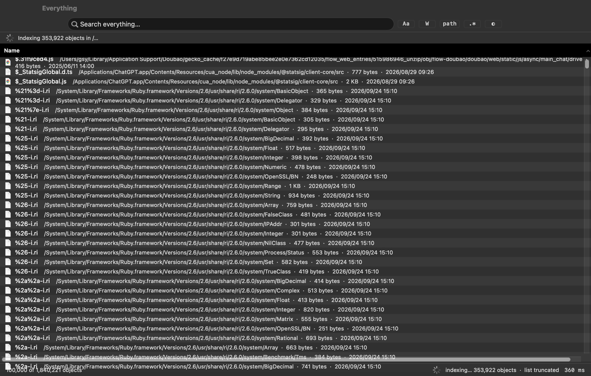
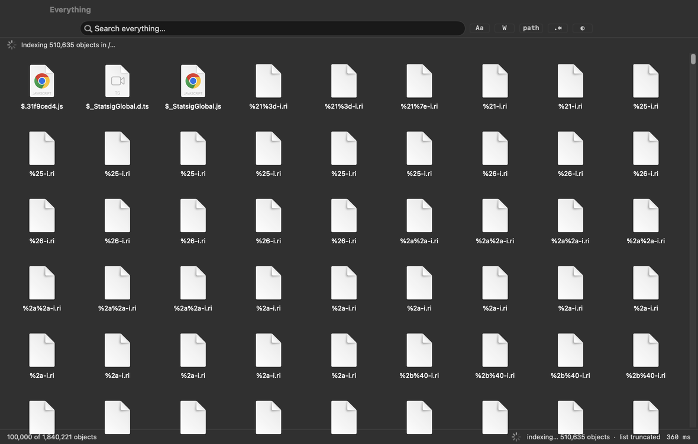

# Everything for macOS

[](https://github.com/532313/everything-for-macos/actions/workflows/ci.yml)
[](https://github.com/532313/everything-for-macos/releases)
[](LICENSE)

Windows 版 **Everything** 的 macOS 原生复刻：一个**常驻内存的全盘文件索引**，加上**随打随出的即时搜索**。
纯 Swift + AppKit 实现，只用 Xcode Command Line Tools 就能从源码构建（无需 Xcode 工程、无第三方依赖）。

```
build/Everything.app       ← 双击即用的图形界面应用
build/everything-cli       ← 同一套索引引擎的命令行前端
```

---

## 1. 快速开始

### 直接下载（无需编译）

到 [Releases](https://github.com/532313/everything-for-macos/releases) 下载最新的
`Everything-<版本>-macos.zip`，解压后把 `Everything.app` 拖进 `/Applications` 即可。
产物是**通用二进制**（Apple Silicon + Intel），最低支持 **macOS 13**。

> 应用使用 ad-hoc 签名（未做 Apple 公证），首次打开若被 Gatekeeper 拦下：
> 右键点应用 → **打开** → 再点「打开」；或执行
> `xattr -dr com.apple.quarantine /Applications/Everything.app`。

### 从源码构建

```bash
git clone https://github.com/532313/everything-for-macos.git
cd everything-for-macos
make            # 等价于 ./build.sh：编译 App + CLI（清缓存约 40 秒）
make run        # 构建并启动图形界面
make test       # 68 项断言自测
make verify     # 校验真实索引缓存的结构不变量
make install    # 复制到 /Applications
```

想构建通用二进制（同时含 Apple Silicon 与 Intel）：

```bash
UNIVERSAL=1 ./build.sh
```

`build.sh` 默认以 `-target <arch>-apple-macos13.0` 编译，所以产物的最低系统版本是 13.0
（不加这个参数就会继承构建机的系统版本，例如 `minos 27.0`，别人就无法运行）。

首次启动会在后台建立全盘索引（本机约 20 秒 / 180 万个对象），期间界面已经可用：搜索会作用于**已经索引的部分**，
状态栏显示 `indexing… N objects` 与进度。索引建成后写入缓存（`~/Library/Application Support/Everything/index.bin`），
下次启动**秒开**，并通过 FSEvents 的断点续传补齐关闭期间的变化。

> **权限**：macOS 会限制对 `~/Library/Mail`、`~/Library/Messages`、其他 App 容器等目录的访问。
> 需要完整结果时，请在 **系统设置 ▸ 隐私与安全性 ▸ 完全磁盘访问权限** 中把 `Everything.app` 加进去。
> 未授权时这些目录会被计入 `skipped`，其余一切照常工作。

---

## 2. 与 Windows 版 Everything 的功能对照

| Everything（Windows） | 本实现（macOS） | 说明 |
|---|---|---|
| 读取 NTFS MFT 秒建索引 | `readdir` + `lstat` 多线程并行遍历，按目录动态抢活 | 20 秒量级扫完 180 万对象 |
| 内存列式索引（紧凑记录 + 路径池） | 每个对象 32 字节记录 + 单一 UTF-8 路径缓冲区，**按路径全序排列** | 排序后子树删除=两次二分，前缀查询=一次跳转 |
| 随打随出的即时搜索 | 内存线性扫描 + 极小 RPN 求值器 | 180 万对象约 27 ms，500 万对象约 225 ms |
| USN Journal 增量更新 | **FSEvents 文件级事件** + 增量合并 | 重命名/新建/删除/修改统一按 “lstat 存在与否” 判定 |
| 索引常驻内存 | 索引序列化缓存 + `lastEventID` 续传 | 重启不重扫 |
| `ext:` `size:` `dm:` `path:` `regex:` `wfn:` … | 全部实现（见第 4 节） | 另有 `depth:` `parent:` `dc:` `package:` `symlink:` `exec:` |
| AND / OR / NOT / 通配符 / 分组 | 全部实现，`|` 优先级低于空格（AND） | `<a|b> c` 与 `(a|b) c` 等价 |
| Filters（Audio/Video/Document…） | 顶栏下拉 + `type:` 宏 | 扩展名表内置 |
| 结果表可排序、右键菜单、复制路径、废纸篓、导出 | 全部实现 | 另有 Quick Look、在终端打开、打开方式 |
| Everything 服务 / HTTP / ETP | 未实现 | 见第 8 节 |

### 视图模式

顶栏右侧的切换器（或 **视图 ▸ 视图模式**，`⌘1`~`⌘4`）可在四种呈现方式间切换，选择会被记住：

| 模式 | 快捷键 | 说明 |
|---|---|---|
| **详细信息 Details** | `⌘1` | 六列表格：名称 / 路径 / 大小 / 修改时间 / 创建时间 / 类型，行高 20 |
| **列表 List** | `⌘2` | 单列紧凑模式（行高 17），每行把路径、大小、修改时间内联显示在文件名之后，同样宽度能看到约 1.4 倍行数 |
| **图标 Icons** | `⌘3` | 网格视图，64 pt 图标 + 文件名，**优先使用 Quick Look 真实缩略图**（图片、PDF、视频、代码等），失败时回退到文件类型图标 |
| **大图标 Large Icons** | `⌘4` | 128 pt 缩略图 + 文件名 + 大小说明 |

图标/大图标视图为懒加载：只为可见单元格生成缩略图（有上限 1200 项的有界缓存），
所以即使结果有 10 万行也能流畅滚动。**视图 ▸ 在图标视图中使用文件预览** 可关掉缩略图只显示类型图标。

封面生成分两条路，按类型自动选择：

| 类型 | 方式 | 说明 |
|---|---|---|
| 视频（mp4/mov/m4v/hevc…） | **AVFoundation `AVAssetImageGenerator`** | 取第 1 秒的真实画面帧（失败再退到第 0 秒），`appliesPreferredTrackTransform` 保证竖屏视频方向正确 |
| 其它（图片/PDF/文档/代码…） | Quick Look `QLThumbnailGenerator` | 系统预览扩展，取 `.thumbnail`，没有时退到 `.icon` |
| 文件夹 / 关闭预览 / 两者都失败 | 文件类型图标 | 缓存于 `IconCache` |

两个坑记在这里：`QLThumbnailRepresentation.nsImage` 的 `size` **恒为 0×0**（必须改用它的 `cgImage` 构造图片）；
Quick Look 对不少视频（例如大疆的 MP4）只返回通用胶片图标、拿不到画面帧，所以视频必须走 AVFoundation。





### 界面速览（快捷键）

| 操作 | 快捷键 |
|---|---|
| 聚焦搜索框 | `⌘F` |
| 清空搜索 | `⌘⇧K` 或 `Esc` |
| 打开选中项 | `Return` / `⌘O` / 双击 |
| Quick Look 预览 | `Space` / `⌘Y` |
| 在 Finder 中显示 | `⌘⇧R` |
| 在终端打开 | `⌘⇧T` |
| 复制文件名 / 完整路径 / 文件本体 | `⌘C` / `⌘⇧C` / `⌥⌘C` |
| 移到废纸篓 | `⌘⌫` |
| 全选结果 | `⌘A` |
| 显示隐藏文件 | `⌘⇧H` |
| 重建索引 | `⌘⇧B` |
| 设置 | `⌘,` |

**在结果列表里直接打字会自动转发到搜索框**，不需要先点回搜索框——这是 Everything 最顺手的地方，已完整保留。

---

## 3. 架构

```
Sources/Core/                 索引与查询引擎（GUI 与 CLI 共用）
  FSEntry.swift               32 字节列式记录 + 标志位 + 过滤器扩展名表
  FileIndex.swift             路径池 + 记录数组 + 二分/前缀/子树查找
  Walker.swift                多线程目录遍历（共享工作队列 + 每线程分片 + 并行归并）
  Query.swift                 查询语法解析 → RPN 程序；NFC/NFD 与大小写字节变体
  Search.swift                求值器、top-K 选择、结果快照
  IndexDatabase.swift         快照发布、增量合并、缓存读写、状态机
  FSWatcher.swift             FSEvents 封装（文件级、断点续传、丢弃检测）
Sources/App/                  AppKit 图形界面
  AppController.swift         全局状态与动作（菜单/工具栏目标）
  MainWindowController.swift  搜索栏、结果表（NSTableView）、状态栏、右键菜单
  SettingsWindowController.swift / SyntaxWindowController.swift / MainMenu.swift
  FileActions.swift           打开/显示/废纸篓/复制/导出 CSV/Quick Look
Sources/CLI/                  everything-cli + self-test
```

### 关键设计

1. **列式 + 排序的索引。** 所有路径挤在一个 `[UInt8]` 里，记录只有 `pathOff/pathLen/nameLen/flags/size/mtime/btime`，
   32 字节、无指针、无 `String`。记录按路径全序排列，于是：
   点查 = `O(log n)` 二分；子树删除 = 两次二分定位区间；`path:`/`parent:` 前缀匹配 = 顺序局部性极好。

2. **并行遍历 + 并行归并。** 目录工作队列带在途计数，空闲线程阻塞等待而不是提前退出，天然负载均衡
   （`~/Library/Caches` 这类超大树不会拖慢整体）。每个线程写自己的分片并在本地排序，最后按对数轮次
   两两并行归并成一个全局有序索引。

3. **读写分离的快照发布。** 写入（FSEvents 批处理）在独立串行队列上**构造全新的不可变快照**，再原子替换；
   搜索只读取当前快照指针。因此搜索**永远不会被索引更新阻塞**，更新也不会被长搜索拖住。

4. **匹配不分配内存。** 查询编译成 RPN 指令序列（字面量、通配、正则、扩展名、大小、日期、深度、属性、
   AND/OR/NOT）。字面量按字节比较，并预先展开为**大小写 + NFC/NFD 变体**——所以 `café` 既能命中 NFC 也能命中
   NFD 文件名，而全程零 `String` 分配。（注意 Swift 的 `String ==` 视 NFC/NFD 为相等，本引擎因此一律按字节比较。）

5. **结果快照。** 搜索返回的是一份把命中行路径拷贝出来的紧凑快照（最多 `maxResults` 行）。UI 懒加载渲染可见行，
   索引继续变更也不影响当前列表；改动排序键只重排/重选 top-K，不会读到不一致的数据。

---

## 4. 查询语法

```
alpha beta                AND（所有词都要命中）
alpha|beta                OR
!alpha                    NOT
(a|b) c                   分组（也可写 <a|b> c）
"exact phrase"            引号短语
*.png  report?.txt        通配符：* 任意串，? 任意一个字符
ext:png;jpg               扩展名列表（大小写不敏感）
ext:                      无扩展名的文件
file:   folder:           只要文件 / 只要文件夹
size:>10mb                大小比较（b/kb/mb/gb/tb，1024 进制）
size:1kb..1mb             大小区间
size:empty                0 字节文件
size:tiny…gigantic        预设档位（10KB/100KB/1MB/16MB/128MB）
dm:today                  修改时间（yesterday/thisweek/lastmonth/thisyear…）
dm:>2024-01-01            在某日期之后修改
dm:2024-01-01..2024-02-01 修改时间区间
dc:thisyear               创建时间
path:src                  在完整路径中匹配
parent:build              匹配父目录名
depth:2   depth:1..3      相对索引根的深度
startwith:log  endwith:.bak   名称前/后缀锚定
wfn:*.md                  整文件名通配（锚定）
regex:^main.*\.swift$     正则
case:x   wholeword:x      针对该词的搜索选项
hidden:  symlink:  package:  exec:   属性过滤
type:audio  type:source   按类别过滤
sort:size  descending:    在查询里指定排序
```

排序字段：`name` `path` `size` `modified` `created` `ext` `kind`。

---

### 文件类型过滤器（Filters / `type:`）

九个过滤器内置扩展名表，规则是**每个扩展名只归属一个类别**，避免"PDF 跑进图片"这类串类：

| 过滤器 | 关键词 | 覆盖 |
|---|---|---|
| All | `all` | 不限 |
| Audio | `audio` | mp3 / wav / flac / m4a / aac / ogg … |
| Compressed | `compressed` | zip / rar / 7z / tar / gz / dmg / iso … |
| Document | `document` | **pdf** / doc(x) / xls(x) / ppt(x) / txt / md / csv / json / xml … |
| Executable | `executable` | app / command / sh / py / js / jar / dylib … |
| Folder | `folder` | 目录（等价 `folder:`） |
| Picture | `picture` | jpg / png / heic / raw / psd / **svg / ai / eps / ps** … |
| Video | `video` | mp4 / mov / mkv / avi / webm / m4v … |
| Source code | `source` | swift / ts / js / py / c / h / go / rs / java / html / json … |

少数扩展名**有意**同时属于两类（已在自测中断言白名单）：`.md/.html/.json/.yaml/.xml/.tex/.cfg/.ini` 既算文档也算源码，
`.sh/.bash/.zsh/.fish/.bat/.cmd/.js/.py/.rb/.php/.pl/.ts` 既算脚本也算可执行，`.jar` 既是压缩包也是可执行。
其余 250+ 个扩展名必须唯一归属；`--selftest` 里有一组回归断言盯着这条规则（含 `pdf` 属 Document、`eps/ps` 属 Picture、
`ts` 属 Source 而非 Video）。

## 5. 命令行 `everything-cli`

```bash
build/everything-cli --help
build/everything-cli -n 20 'ext:swift size:>100kb'          # 前 20 条
build/everything-cli --json 'dm:today path:Downloads'       # 机器可读
build/everything-cli -0 'ext:log' | xargs -0 du -h          # 管道友好
build/everything-cli --count 'ext:tmp size:>1gb'            # 只要数量
build/everything-cli --root /Volumes/Backup -n 50 'report*' # 换索引根
build/everything-cli --watch 30 'ext:download'              # 常驻并打印增量变化
build/everything-cli --selftest                             # 68 项断言
EVERYTHING_UI_SMOKE=/tmp/ui EVERYTHING_UI_SMOKE_QUERY='ext:mp4' \
  ./build/Everything.app/Contents/MacOS/Everything           # UI 冒烟测试：遍历四种视图并截图
```

常用参数：`-r/--root`、`-n/--limit`、`-s/--sort`、`--desc`、`--filter`、`-c/--case`、
`-w/--whole-word`、`-p/--path`、`-e/--regex`、`--hidden`、`--folders`、`--files`、`--count`、
`--json`、`-0/--print0`、`--rebuild`、`--no-cache`、`--watch`、`--index`（索引缓存目录）。

---

## 6. 实测数据（本机 Apple Silicon，macOS 27）

实测环境：Apple Silicon / macOS 27，索引根 `/`，真实全盘（未沙箱、授予普通用户权限）。

| 项目 | 数值 |
|---|---|
| 全盘冷索引 | **1,848,279 个对象（1,465,588 文件 + 382,691 目录）/ 23.8 s**，跳过 845 个无权访问项 |
| 索引内存 | 记录 32 B × 185 万 = 59 MB，路径池 222 MB，合计 **281 MB** |
| 索引缓存 | 281 MB（`~/Library/Application Support/Everything/index.bin`），重启加载即用 |
| 搜索延迟 | `swift` 6970 命中 **52 ms**；`ext:swift size:>10kb` 28 ms；`ext:png\|ext:jpg dm:thisyear` 43249 命中 46 ms；`!ext:txt !folder:` 144 万命中 40 ms |
| 实时更新 | FSEvents 端到端实测：新建文件 → `1 matches`，删除 → `0 matches`（0.6 s 延迟 + 0.6 s 去抖） |
| 自测 | **68 项断言全部通过**（查询语法、排序、top-K 截断、增量增删、同批重复事件、新目录递归、缓存往返） |
| 结构校验 | `make verify` 对真实缓存做 8 项不变量检查（区间合法 / 名称是最后一段 / NUL 完整 / 严格升序 / 无重复 / 二分一致 / 子树区间自包含 / 访问器非空）→ **INDEX OK** |
| 压力测试 | 批量新建 2000 + 删除 1000 + 整目录重命名 → 实时计数 2000→1000，旧路径 0 命中，校验 INDEX OK |
| GUI 端到端 | 应用运行中新建文件 → 事件→合并→快照→退出落盘 → 直接读缓存查询命中 **1 of 1**，`!! add produced no record` 归零 |
| 诊断开关 | `EVERYTHING_DEBUG_LOG=/path/to/log` 输出扫描/事件/合并全链路追踪，便于排障 |
| UI 冒烟测试 | `EVERYTHING_UI_SMOKE=<dir>`：应用启动后自动遍历四种视图模式，输出每种模式的可见视图、列集合、行高、网格项尺寸与 PNG 截图；随后做**滚动稳定性**回归：滚到第 2000 行后连续触发后台索引刷新，断言滚动位置与选中项不变、真实数据变化时刷新但视口不动。最后写出 `smoke-report.json` 并退出 |

---

## 7. 已知限制

- **内存占用**：索引常驻内存（与 Everything 相同思路）。想更省内存可以在设置里只索引常用根目录，
  而不是整个 `/`。
- **内容搜索**：只索引文件名/路径/元数据，不索引文件内容（Everything 亦如此；`content:` 未实现）。
- **`da:`（访问时间）**：macOS 默认关闭访问时间更新，因此 `da:` 实际退化为修改时间。
- **卷支持**：默认索引 `/`，可选索引 `/Volumes/*`；单卷深度/大小语义以索引根为基准。
- **权限**：未授予完全磁盘访问权限时，受保护目录会被跳过（统计在 `skipped` 里）。
- 索引缓存目前是全量重写（非增量日志），大索引下保存约需 1~2 秒；增量保存已做 45 秒去抖。

## 8. 未实现的 Everything 特性（如需可继续扩展）

Everything 服务/HTTP 服务器、ETP/FTP 协议、EFU 文件列表导出、文件内容搜索、重复文件查找器、
按 `content:` 的正则内容检索、多窗口。核心索引与查询引擎已经把这些都预留了接口（`QueryOptions`、
`ResultSet`、`IndexDatabase` 均为独立可复用层）。

---

## 9. 开发笔记

```bash
make            # 全量构建
make test       # 68 项断言
make verify     # 结构校验（真实缓存）

# 只做类型检查（快）
export TMPDIR="$PWD/.buildtmp"
swiftc -swift-version 5 -module-cache-path .modulecache -typecheck Sources/Core/*.swift Sources/App/*.swift

# 手工构建某个工具
swiftc -O -swift-version 5 -module-cache-path .modulecache \
  Sources/Core/*.swift Tools/verify/main.swift -o build/everything-verify
```

### 质量保障（三层）

1. **`--selftest`（68 项）**：在合成目录树上验证查询语义（AND/OR/NOT/分组/通配/正则/大小/日期/深度/属性/过滤器）、
   top-K 截断、增量新增与删除、同批重复事件折叠、新目录递归展开、缓存往返。
2. **`verify`**：直接读取真实索引缓存，逐条校验结构不变量，并在随机样本上交叉验证二分查找与子树区间。
   UI 侧另有 `EVERYTHING_UI_SMOKE` 冒烟测试，覆盖四种视图的切换与**滚动位置稳定性**。

> **关于后台刷新**：索引由 FSEvents 持续更新，但**索引变化不再打断浏览**——只有当查询/排序/过滤器变化时列表才回到顶部；
> 后台更新如果对当前结果没有可见影响（比较匹配数、行数与首末行指纹）就完全不刷新，有影响时也只更新内容、
> 保留滚动位置与选中项；用户正在滚动时更新会延后到停止滚动之后。
3. **压力测试**：`--watch` 常驻时批量新建 2000 / 删除 1000 / 重命名整个目录，再用 `verify` 复核。

缓存加载时还会做一次线性完整性检查：若发现乱序或重复（例如旧版本写下的缓存），会**就地排序去重并异步回写**，
而不是把损坏的数据继续喂给搜索。

### 实时更新链路的四个已修复缺陷（第三轮验证发现）

GUI 端到端验证（运行中新建文件 → SIGTERM 退出 → 直接读磁盘缓存校验）暴露出四个真实缺陷，均已修复并有回归依据：

1. **未终止路径传给 `lstat`（最严重）**：增量新增路径以 `[UInt8]` 传递，而数组没有 NUL 结尾，
   `lstat` 会越界读取，导致**新建文件被随机静默丢弃**（分片比 adds 少一条，合并后总数不增长）。
   小数组偶尔碰巧成功，所以只在长跑/压力场景暴露。现统一走 `IndexDatabase.withCString`。
2. **去抖任务被饿死**：每批事件都 `cancel()` 并重排 0.6 秒后的应用任务，在持续有文件活动的机器上
   （监听 `/` 时永远如此）该任务**永远不会执行**，索引停止更新。改为前沿合并（已有待执行任务就不再重排）。
3. **全盘扫描窗口内的事件被丢弃**：扫描结束后用 `sinceNow` 重启 FSEvents 流，扫描期间（最长 40 秒）的变化全部丢失。
   改为扫描期间只累积事件、扫描结束立即应用（事件量有界）。
4. **首次扫描后缓存静默保存失败**：未收到任何事件时 `lastEventID` 是 `UInt64.max`，
   `JSONSerialization` 无法表示该值，保存直接失败。现以字符串无损持久化。

另外补充：单实例防护（多个实例会争抢同一缓存文件）、SIGTERM/SIGINT 落盘、缓存超过 30 分钟时
先秒开旧索引再后台刷新。

- 构建只依赖 Xcode Command Line Tools（本机 Swift 6.4）。界面刻意使用 **纯 AppKit**：
  Command Line Tools 缺少 SwiftUI 的宏插件（`SwiftUIMacros`），`@State` 等宏无法编译；
  AppKit 同时让百万行表格的懒加载与排序行为完全可控。
- 代码全部由命令行工具构建，`.app` 使用 ad-hoc 签名（`codesign -s -`），
  因此首次打开若被 Gatekeeper 拦下，右键 → 打开即可。

## 10. 磁盘占用与清理

```bash
make clean          # 删除 build/ 与编译缓存（.modulecache、.buildtmp）
```

| 位置 | 大小 | 说明 |
|---|---|---|
| `build/` | ~2 MB | 产物（Everything.app + everything-cli），`make clean` 可删后重建 |
| `Resources/` | ~1.7 MB | 图标与文档截图 |
| `Sources/` + `Tools/` | ~0.8 MB | 源码；`Tools/testmedia/` 是 ffmpeg 现造的测试素材，可随时删除并用 `Tools/make_testmedia.sh` 重建 |
| `~/Library/Application Support/Everything/index.bin` | 约 280 MB | **应用索引缓存**（不是构建产物）。删掉后下次启动会重新全盘索引（约 24 秒） |

## 11. 目录一览

```
build.sh                 一键构建脚本
Resources/Info.plist     应用元信息（含权限用途说明）
Resources/AppIcon.icns   应用图标
Sources/Core/            索引 + 查询引擎
Sources/App/             AppKit 界面
Sources/CLI/             命令行 + 自测
Tools/                   开发期工具
  verify/                 索引结构校验器（make verify 会重新编译它）
  thumb/                  Quick Look / AVFoundation 封面生成诊断器
  winlist/                窗口列举（验证 GUI 真的起了窗口）
  make_icon.py            图标生成脚本（可复现 AppIcon.icns）
  make_testmedia.sh       用 ffmpeg 生成缩略图测试素材（测试完可删）
build/Everything.app     产物
build/everything-cli     产物
```
